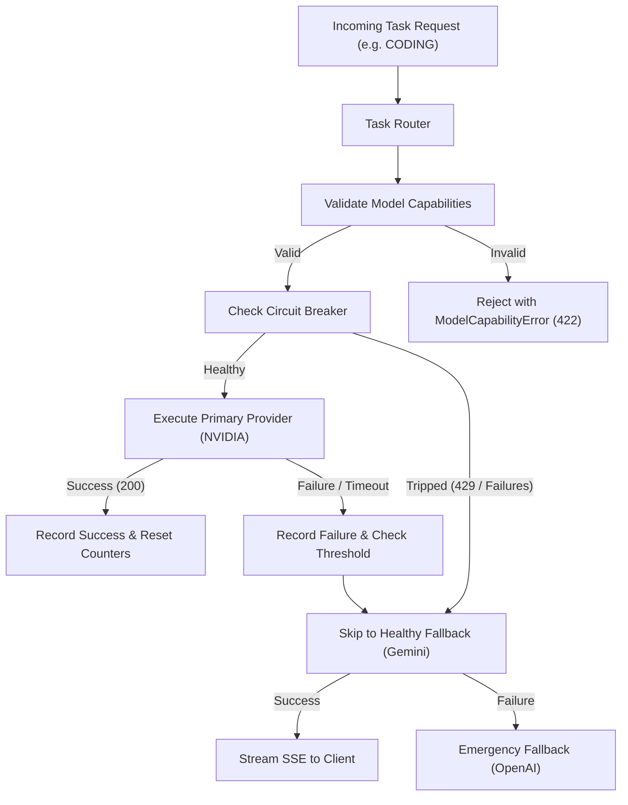

# Sukoon AI — Capability-Based AI Model Routing Architecture

## 1. Architectural Principles

Sukoon AI coordinates multiple AI inference providers (**Google Gemini**, **NVIDIA NIM**, and **OpenAI**) through an intelligent, capability-driven task router (`src/lib/ai/task-router.ts`).

### Guiding Principles:
1. **Zero Companion Disruption:** The trusted primary companion (`gemini-3.5-flash-lite`) remains the default for all standard conversations. Sensitive emotional discussions and crisis states are never automatically re-routed to experimental or unvetted endpoints.
2. **Capability Validation Pre-Execution:** Before any model is invoked for a task, its capabilities are validated against the task's required capability constraints (`TASK_CAPABILITY_REQUIREMENTS`). Unsupported models are rejected before network requests are dispatched.
3. **Safe, Finite Fallback Chaining:** If a primary model encounters downtime or rate limits (HTTP 429), the task router traverses a healthy fallback chain up to a maximum depth of 2 hops. Infinite retry loops and duplicate message creations are strictly prohibited.
4. **Context & Language Invariance:** User conversational turns, language preferences (Hinglish, Hindi, English), and relevant consented memories are preserved intact across provider boundaries.
5. **Safety Pipeline Immutability:** Crisis detection, de-escalation interception, prompt injection sanitization, and output guardrails execute independently of which AI provider handles the completion.

---

## 2. Task Routing Policy Matrix

| Task Category | Minimum Required Capabilities | Default Provider | Default Model | Fallback Providers | NVIDIA Allowed? | Policy Notes |
| :--- | :--- | :---: | :--- | :---: | :---: | :--- |
| **`COMPANION_CHAT`** | `TEXT_STREAMING`, `SYSTEM_INSTRUCTIONS` | **Gemini** | `gemini-3.5-flash-lite` | OpenAI | Admin Opt-In Only | Core companion chat. Preserves empathetic, non-clinical conversational tone. |
| **`EMOTIONAL_SUPPORT`** | `TEXT_STREAMING`, `SYSTEM_INSTRUCTIONS` | **Gemini** | `gemini-3.5-flash-lite` | OpenAI | **Strictly Denied** | Protected domain. Vulnerable emotional exchanges are never routed to experimental endpoints. |
| **`COMPLEX_REASONING`** | `TEXT_STREAMING`, `REASONING_EFFORT` | **NVIDIA** *(if configured)* / **Gemini** | `nvidia/nemotron-3.5-super-vl-120b-a12b` | Gemini, OpenAI | **Yes** | Deep analytical evaluations, multi-step problem solving, and structured planning. |
| **`CODING`** | `TEXT_STREAMING`, `CODING` | **NVIDIA** *(if configured)* / **Gemini** | `minimaxai/minimax-m3.1-flash` | Gemini, OpenAI | **Yes** | High-throughput coding assistance, code review, and debugging assistance. |
| **`CONVERSATION_SUMMARY`** | `TEXT_NON_STREAMING` | **Gemini** | `gemini-3.5-flash-lite` | NVIDIA, OpenAI | **Yes** | Context-window compression and background conversation titling. |
| **`JOURNAL_SUMMARY`** | `TEXT_NON_STREAMING` | **Gemini** | `gemini-3.5-flash-lite` | NVIDIA, OpenAI | **Yes** | Generating weekly/monthly mood trends and reflection takeaways. |
| **`TEXT_TO_SPEECH`** | `TEXT_TO_SPEECH` | **NVIDIA** | `nvidia/magpie-tts-zeroshot` | None | **Yes (Preview)** | Experimental TTS preview. Microphone and live voice cloning are unmounted in MVP. |
| **`IMAGE_ANALYSIS`** | `VISION_IMAGE` | **Gemini** | `gemini-2.5-flash` | NVIDIA, OpenAI | **Yes** | Visual understanding of attached screenshots, photos, and drawings. |
| **`VIDEO_ANALYSIS`** | `VIDEO_INPUT` | **NVIDIA** | `nvidia/cosmos-nemotron-34b` | None | **Disabled** | Cosmos physical-world foundation models are kept disabled unless explicitly configured. |

---

## 3. Fallback & Circuit Breaker Mechanics

### Circuit Breaker Rules:
- **Failure Threshold:** 3 consecutive failures trips the circuit breaker for that provider.
- **Immediate Trip on 429:** Any HTTP 429 (quota or rate-limit exceeded) trips the circuit breaker immediately.
- **Cooldown Window:** 60 seconds. During this window, all calls route immediately to the next healthy provider in the fallback chain without stalling for timeouts.
- **Auto-Recovery:** Probing via the Admin AI Settings UI or automatic health checks resets the circuit once the upstream provider responds with HTTP 200.

---

## 4. Admin AI Configuration Screen (`/admin/ai-settings`)

Sukoon AI provides an administrative configuration interface:

### Features:
1. **Provider Status Dashboard:** Live latency, health status (Healthy / Degraded / Unconfigured), and default model for Gemini, NVIDIA NIM, and OpenAI.
2. **NVIDIA Deployment Safeguard Banner:** Prominent notification highlighting `DEVELOPMENT_ONLY` constraints for free hosted endpoints.
3. **Live Connectivity Probes:** One-click non-destructive test buttons that measure round-trip latency to each provider.
4. **Task Routing Matrix:** Dropdown selectors for preferred provider and assigned model per task category, with checkboxes to toggle NVIDIA or OpenAI routing permissions.
5. **Registered Model Catalog:** Interactive browser detailing context limits, capabilities, and pricing estimates for all verified models.
6. **Zero Secret Exposure:** API keys are never rendered in full in the browser; only masked prefixes (`nvap...****`) are returned over the network.

