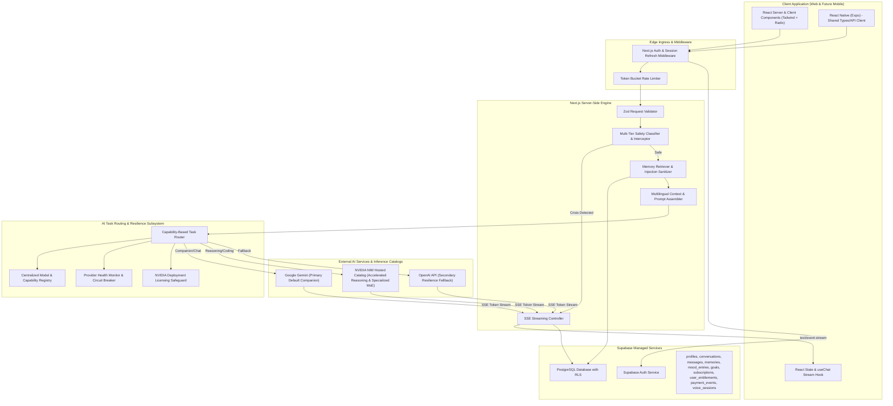

# ARCHITECTURE.md: System Architecture & Technical Design

## 1. System Overview & Technology Stack

Sukoon AI is engineered as a secure, high-performance, modular full-stack application built using:
- **Web Frontend:** Next.js (App Router), TypeScript, Tailwind CSS, Radix UI accessible primitives, Lucide Icons.
- **Backend & APIs:** Next.js Route Handlers (Server-Side Only), Edge & Node.js runtimes.
- **Database & Authentication:** Supabase PostgreSQL with Row Level Security (RLS) & Supabase Auth.
- **AI Engine:** OpenAI Responses API / Streaming Chat API, wrapped strictly server-side with prompt boundaries.
- **Validation:** Zod schemas applied universally on API inputs, database queries, and AI outputs.
- **Testing:** Vitest for fast unit & integration testing; Playwright for end-to-end browser flows.
- **Mobile Architecture:** Decoupled business logic, shared Zod schemas, and standard REST/SSE endpoints enabling seamless integration with React Native (Expo).

---

## 2. Architecture & Data Flow



---

## 3. Key Architectural Decisions (ADRs)

### ADR-01: Next.js App Router with Server-Side AI Streaming
- **Decision:** All OpenAI API calls originate strictly from Next.js server-side route handlers (`/api/chat`).
- **Rationale:** Protects OpenAI API keys and Supabase service-role keys from client bundles; enables server-side token usage accounting, rate limiting, and critical safety interception before any generation occurs.

### ADR-02: Zero Implicit Memory Storage
- **Decision:** Memories are stored in a dedicated `memories` table only when explicitly confirmed by the user or when the user has enabled granular auto-consent in their profile.
- **Rationale:** Emotional companions build trust through explicit consent. Unwanted retention of sensitive emotional admissions damages user psychological safety.

### ADR-03: Prompt Injection & Memory Poisoning Defense
- **Decision:** User messages and stored memories are treated as strictly untrusted inputs. They are wrapped in explicit boundary tags (`<untrusted_user_input>`, `<verified_memories>`) and reinforced with immutable system directives.
- **Rationale:** Prevents adversarial inputs from overriding clinical safety rules, extracting system instructions, or causing the AI to adopt improper persona behaviors.

### ADR-04: Row Level Security (RLS) as Primary Authorization Defense
- **Decision:** Every PostgreSQL table in Supabase has RLS enabled with explicit `auth.uid() = user_id` policies.
- **Rationale:** Defense-in-depth ensures that even if an application-layer bug queries a table without an explicit user filter, the database engine enforces tenant isolation and prevents cross-user leaks.

### ADR-05: Modular Monorepo Preparation for Mobile
- **Decision:** Maintain pure domain logic, schemas, and types in `src/types` and `src/lib/contracts` so they can be published or symlinked into an Expo React Native workspace without rewrite.

### ADR-06: Modular Multi-Provider Architecture with NVIDIA NIM and Capability Routing
- **Decision:** Decouple AI inference from any single cloud vendor using a modular `BaseAIProvider` adapter contract (`GeminiProvider`, `NVIDIAProvider`, `OpenAIProvider`), coordinated by an intelligent `TaskRouter`, `ModelRegistry`, and `ProviderHealthMonitor`.
- **Rationale:** Prevents single-vendor lock-in, eliminates downtime risk through non-infinite automatic fallback, optimizes cost using Gemini Flash-Lite for everyday empathetic chat while leveraging NVIDIA NIM hosted models (`minimaxai/minimax-m3.1-flash`, `nvidia/nemotron-3.5-super-vl-120b-a12b`) for accelerated reasoning and coding. Enforces critical licensing safeguards marking NVIDIA free catalog endpoints as `DEVELOPMENT_ONLY`.

---

## 4. Directory & Module Structure

```text
sukoon-ai/
├── src/
│   ├── app/
│   │   ├── (auth)/
│   │   │   ├── login/page.tsx
│   │   │   └── signup/page.tsx
│   │   ├── (app)/
│   │   │   ├── chat/
│   │   │   │   ├── page.tsx
│   │   │   │   └── [id]/page.tsx
│   │   │   ├── memories/page.tsx
│   │   │   ├── mood/page.tsx
│   │   │   ├── goals/page.tsx
│   │   │   └── settings/page.tsx
│   │   ├── api/
│   │   │   ├── chat/route.ts
│   │   │   ├── conversations/
│   │   │   │   ├── route.ts
│   │   │   │   └── [id]/route.ts
│   │   │   ├── memories/
│   │   │   │   ├── route.ts
│   │   │   │   └── [id]/route.ts
│   │   │   ├── mood/route.ts
│   │   │   ├── goals/route.ts
│   │   │   └── user/
│   │   │       ├── export/route.ts
│   │   │       └── delete/route.ts
│   │   ├── layout.tsx
│   │   └── page.tsx
│   ├── components/
│   │   ├── auth/           # Login, Signup, AuthCard
│   │   ├── chat/           # ChatWindow, MessageBubble, InputBar, HelplineCard, Sidebar
│   │   ├── memories/       # MemoryCard, MemoryVault, AddMemoryModal
│   │   ├── mood/           # MoodScale, EmotionBadge, MoodHistory
│   │   ├── ui/             # Accessible primitives (Button, Dialog, Dropdown, Toast)
│   │   └── layout/         # Header, Navbar, ThemeProvider
│   ├── lib/
│   │   ├── ai/             # OpenAI client, multilingual prompt builders, stream parser
│   │   ├── safety/         # Crisis keywords, regex patterns, safety classifier, helplines
│   │   ├── supabase/       # Server, Client, and Middleware Supabase clients
│   │   ├── validation/     # Zod validation schemas for all entities
│   │   └── utils/          # Formatting, language detection, sanitization
│   └── types/              # TypeScript definitions for DB, Chat, Memory, Safety
├── supabase/
│   └── migrations/         # Supabase PostgreSQL DDL and RLS policies
├── tests/
│   ├── unit/               # Vitest unit tests (prompts, safety, validation, RLS)
│   └── e2e/                # Playwright end-to-end tests
├── public/                 # Static assets, audio, logos
├── .env.example            # Documented environment variables
├── package.json
├── tsconfig.json
├── tailwind.config.ts
└── vitest.config.ts
```
