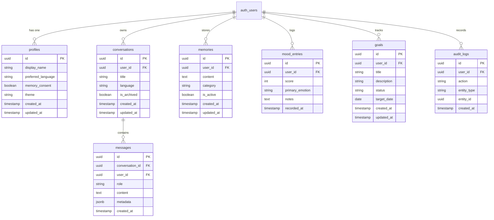

# DATABASE.md: Database Schema, Migrations & Row Level Security (RLS)

## 1. Overview & Security Model
Sukoon AI relies on Supabase PostgreSQL for persistent storage.

### Security Directives:
- **Default Deny:** Row Level Security (RLS) is enabled on every user-facing table.
- **Strict Tenant Isolation:** Every table that stores user data contains a non-nullable `user_id uuid references auth.users(id) on delete cascade` defaulting to `auth.uid()`.
- **Primary Key Standards:** All primary keys utilize standard UUID v4.
- **Soft & Hard Deletion Support:** Conversations can be archived or hard-deleted; account deletion initiates a full cascading purge.

---

## 2. Entity-Relationship Model



---

## 3. Complete DDL & Supabase Migration Script

```sql
-- Migration: 20261029000000_init_sukoon_schema.sql
-- Enables UUID generation
create extension if not exists "uuid-ossp";

-- ============================================================================
-- 1. PROFILES TABLE
-- ============================================================================
create table public.profiles (
  id uuid references auth.users(id) on delete cascade primary key,
  display_name text not null default 'Friend',
  preferred_language text not null default 'hinglish' check (preferred_language in ('hi', 'hinglish', 'en')),
  memory_consent boolean not null default true,
  theme text not null default 'warm-light' check (theme in ('warm-light', 'warm-dark', 'system')),
  created_at timestamptz not null default now(),
  updated_at timestamptz not null default now()
);

alter table public.profiles enable row level security;

create policy "Users can view own profile"
  on public.profiles for select
  using (auth.uid() = id);

create policy "Users can update own profile"
  on public.profiles for update
  using (auth.uid() = id);

create policy "Users can insert own profile"
  on public.profiles for insert
  with check (auth.uid() = id);

-- ============================================================================
-- 2. CONVERSATIONS TABLE
-- ============================================================================
create table public.conversations (
  id uuid primary key default uuid_generate_v4(),
  user_id uuid references auth.users(id) on delete cascade not null default auth.uid(),
  title text not null default 'New Conversation',
  language text not null default 'hinglish' check (language in ('hi', 'hinglish', 'en')),
  is_archived boolean not null default false,
  created_at timestamptz not null default now(),
  updated_at timestamptz not null default now()
);

create index idx_conversations_user_id on public.conversations(user_id);
create index idx_conversations_updated_at on public.conversations(updated_at desc);

alter table public.conversations enable row level security;

create policy "Users can view own conversations"
  on public.conversations for select
  using (auth.uid() = user_id);

create policy "Users can insert own conversations"
  on public.conversations for insert
  with check (auth.uid() = user_id);

create policy "Users can update own conversations"
  on public.conversations for update
  using (auth.uid() = user_id);

create policy "Users can delete own conversations"
  on public.conversations for delete
  using (auth.uid() = user_id);

-- ============================================================================
-- 3. MESSAGES TABLE
-- ============================================================================
create table public.messages (
  id uuid primary key default uuid_generate_v4(),
  conversation_id uuid references public.conversations(id) on delete cascade not null,
  user_id uuid references auth.users(id) on delete cascade not null default auth.uid(),
  role text not null check (role in ('user', 'assistant', 'system')),
  content text not null,
  metadata jsonb not null default '{}'::jsonb,
  created_at timestamptz not null default now()
);

create index idx_messages_conversation_id on public.messages(conversation_id, created_at asc);
create index idx_messages_user_id on public.messages(user_id);

alter table public.messages enable row level security;

create policy "Users can view messages in own conversations"
  on public.messages for select
  using (auth.uid() = user_id);

create policy "Users can insert messages into own conversations"
  on public.messages for insert
  with check (
    auth.uid() = user_id and
    exists (
      select 1 from public.conversations c
      where c.id = conversation_id and c.user_id = auth.uid()
    )
  );

create policy "Users can delete messages in own conversations"
  on public.messages for delete
  using (auth.uid() = user_id);

-- ============================================================================
-- 4. MEMORIES TABLE (Consent-Driven Long-Term Context)
-- ============================================================================
create table public.memories (
  id uuid primary key default uuid_generate_v4(),
  user_id uuid references auth.users(id) on delete cascade not null default auth.uid(),
  content text not null,
  category text not null default 'general' check (category in ('personal', 'career', 'relationship', 'goal', 'preference', 'general')),
  is_active boolean not null default true,
  created_at timestamptz not null default now(),
  updated_at timestamptz not null default now()
);

create index idx_memories_user_id on public.memories(user_id);
create index idx_memories_is_active on public.memories(user_id, is_active);

alter table public.memories enable row level security;

create policy "Users can view own memories"
  on public.memories for select
  using (auth.uid() = user_id);

create policy "Users can insert own memories"
  on public.memories for insert
  with check (auth.uid() = user_id);

create policy "Users can update own memories"
  on public.memories for update
  using (auth.uid() = user_id);

create policy "Users can delete own memories"
  on public.memories for delete
  using (auth.uid() = user_id);

-- ============================================================================
-- 5. MOOD ENTRIES TABLE
-- ============================================================================
create table public.mood_entries (
  id uuid primary key default uuid_generate_v4(),
  user_id uuid references auth.users(id) on delete cascade not null default auth.uid(),
  score int not null check (score between 1 and 5),
  primary_emotion text not null,
  notes text,
  recorded_at timestamptz not null default now()
);

create index idx_mood_entries_user_date on public.mood_entries(user_id, recorded_at desc);

alter table public.mood_entries enable row level security;

create policy "Users can view own mood entries"
  on public.mood_entries for select
  using (auth.uid() = user_id);

create policy "Users can insert own mood entries"
  on public.mood_entries for insert
  with check (auth.uid() = user_id);

create policy "Users can update own mood entries"
  on public.mood_entries for update
  using (auth.uid() = user_id);

create policy "Users can delete own mood entries"
  on public.mood_entries for delete
  using (auth.uid() = user_id);

-- ============================================================================
-- 6. GOALS TABLE
-- ============================================================================
create table public.goals (
  id uuid primary key default uuid_generate_v4(),
  user_id uuid references auth.users(id) on delete cascade not null default auth.uid(),
  title text not null,
  description text,
  status text not null default 'in_progress' check (status in ('in_progress', 'completed', 'paused', 'abandoned')),
  target_date date,
  created_at timestamptz not null default now(),
  updated_at timestamptz not null default now()
);

create index idx_goals_user_id on public.goals(user_id);

alter table public.goals enable row level security;

create policy "Users can view own goals"
  on public.goals for select
  using (auth.uid() = user_id);

create policy "Users can insert own goals"
  on public.goals for insert
  with check (auth.uid() = user_id);

create policy "Users can update own goals"
  on public.goals for update
  using (auth.uid() = user_id);

create policy "Users can delete own goals"
  on public.goals for delete
  using (auth.uid() = user_id);

-- ============================================================================
-- 7. AUDIT LOGS (Privacy & Security Compliance)
-- ============================================================================
create table public.audit_logs (
  id uuid primary key default uuid_generate_v4(),
  user_id uuid references auth.users(id) on delete set null,
  action text not null,
  entity_type text not null,
  entity_id uuid,
  created_at timestamptz not null default now()
);

create index idx_audit_logs_user_id on public.audit_logs(user_id);

alter table public.audit_logs enable row level security;

create policy "Users can view own audit logs"
  on public.audit_logs for select
  using (auth.uid() = user_id);

-- ============================================================================
-- TRIGGERS & AUTOMATION
-- ============================================================================

-- Automatically create profile on new user signup
create or replace function public.handle_new_user()
returns trigger as $$
begin
  insert into public.profiles (id, display_name, preferred_language)
  values (
    new.id,
    coalesce(new.raw_user_meta_data->>'full_name', 'Friend'),
    coalesce(new.raw_user_meta_data->>'preferred_language', 'hinglish')
  );
  return new;
end;
$$ language plpgsql security definer;

create or replace trigger on_auth_user_created
  after insert on auth.users
  for each row execute procedure public.handle_new_user();

-- Automatically update updated_at timestamps
create or replace function public.touch_updated_at()
returns trigger as $$
begin
  new.updated_at = now();
  return new;
end;
$$ language plpgsql;

create trigger tr_conversations_updated_at
  before update on public.conversations
  for each row execute procedure public.touch_updated_at();

create trigger tr_memories_updated_at
  before update on public.memories
  for each row execute procedure public.touch_updated_at();

create trigger tr_goals_updated_at
  before update on public.goals
  for each row execute procedure public.touch_updated_at();
```
