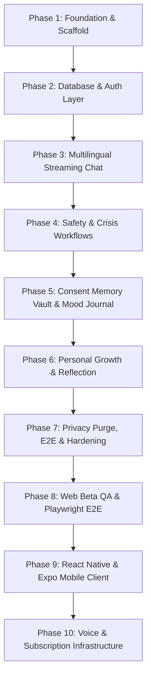

# IMPLEMENTATION_PLAN.md: Sukoon AI Engineering Roadmap

## Milestone Overview

The project is structured into sequential phases. Each phase has explicit scopes, file targets, and automated acceptance criteria. No phase begins before the preceding phase is verified with type checking, unit/integration testing, and build passes.

---

## Phase 1: Project Foundation & Architecture Setup (COMPLETED)
- `package.json`, `tsconfig.json`, `tailwind.config.ts`, `vitest.config.ts`, `.env.example`, `src/lib/env.ts`
- Primitives: Button, Card, Input, Badge, Dialog
- Unit tests: `tests/unit/safety.test.ts`, `tests/unit/validation.test.ts`
- Initial migration: `20261029000000_init_sukoon_schema.sql`
- **Verification Status:** Passed 36/36 tests, 0 type errors, 0 lint warnings.

---

## Phase 2: Database & Authentication Layer (COMPLETED)
- Supabase SSR clients (`src/lib/supabase/client.ts`, `server.ts`, `middleware.ts`).
- Auth routes: `/login`, `/signup`, `/auth/callback`, `/api/auth/signout`.
- Profile service with auto-provisioning fallback (`src/lib/services/profile.ts`).
- RLS tenant isolation tests: `tests/unit/rls.test.ts` (13/13 passed).
- **Verification Status:** Passed 54/54 tests, 0 type errors, production build passed.

---

## Phase 3: Multilingual Streaming Chat Engine (COMPLETED)
- Dual AI Fallback: Google Gemini `gemini-3.5-flash-lite` (free streaming tier) and OpenAI Responses API.
- SSE Streaming endpoint `POST /api/chat` with in-memory token bucket rate limiter & concurrency locks.
- Conversation CRUD (`src/app/api/conversations/`).
- Interactive chat UI with auto-scrolling, thinking indicators, and retry controls.
- **Verification Status:** Passed 69/69 tests, 0 type errors, production build passed.

---

## Phase 4: Companion Personality and Multilingual Support (COMPLETED)
- Version-controlled system prompt registry (`src/lib/ai/prompts/version.ts`, `system-instructions.ts`).
- Non-clinical identity & anti-toxic-positivity directives.
- Extensible language configuration (`src/lib/ai/languages/config.ts`) with first-class `hinglish`, `hi`, `en`.
- AI Orchestrator (`src/lib/ai/orchestrator.ts`) with prompt injection defense and output guardrail inspectors.
- **Verification Status:** Passed 95/95 tests, 0 type errors, production build passed.

---

## Phase 5: Consent-Based Memory Vault (COMPLETED)
- Two-tier consent verification (global profile consent & item active status).
- Sensitive information filter (`src/lib/services/sensitive-filter.ts`) blocking credit cards, PINs, Aadhaar, PAN, passwords.
- Memory CRUD API (`src/app/api/memories/`) with instant hard-deletion.
- Interactive Memory Vault UI with Pause/Resume toggles and category filters.
- **Verification Status:** Passed 114/114 tests, 0 type errors, production build passed.

---

## Phase 6: Mood Journal and Personal Growth (COMPLETED)
- 5-point non-clinical mood check-in with reflection notes and 7-day trajectory summary.
- Personal Growth Goals service with status transitions (`in_progress`, `completed`, `paused`, `abandoned`).
- Explicit non-clinical disclaimers on all mood reports.
- Local browser timezone formatting and deletion controls.
- **Verification Status:** Passed 130/130 tests, 0 type errors, production build passed.

---

## Phase 7: Safety & Privacy Hardening (COMPLETED)
- Multi-tier safety pipeline (`src/lib/safety/detector.ts`): explicit self-harm, ambiguous distress, harmful advice, prompt injection, false positive preservation.
- Anonymized audit logger (`src/lib/security/audit-logger.ts`) with salted SHA-256 user hashes and sensitive key scrubbing.
- DPDP Act 2023 / GDPR Data Portability (`GET /api/user/export`) and Cascading Account Purge (`DELETE /api/user/account`).
- **Verification Status:** Passed 182/182 tests, 0 type errors, production build passed.

---

## Phase 8: Web Beta QA & Playwright E2E (COMPLETED)
- Installed and configured `@playwright/test` for Desktop Chrome and Mobile Chrome.
- Playwright E2E suites: `tests/e2e/home-and-responsive.spec.ts` and `tests/e2e/auth-flow.spec.ts` (18/18 passed).
- Comprehensive API authorization & tenant isolation integration tests: `tests/integration/api-auth-and-rls.test.ts` (19/19 passed).
- Complete user journey test: `tests/integration/full-user-journey.test.ts` (6/6 passed).
- Production build verified: all 16 static and dynamic routes compiled cleanly.
- **Verification Status:** Passed 207/207 Vitest tests, 18/18 Playwright E2E tests, 0 TypeScript errors, 0 ESLint warnings.

---

## Phase 9: React Native & Expo Mobile Client (COMPLETED)
- Built production-ready mobile application under `mobile/` consuming the authenticated backend API.
- Zero duplicated AI/business logic and zero provider secrets exposed.
- Hardware-backed session persistence using `expo-secure-store` via `ExpoSecureStoreAdapter` (iOS Keychain / Android Keystore AES-256 GCM).
- Backend Bearer token support in `src/lib/supabase/server.ts` and `middleware.ts`.
- Mobile screens: `LoginScreen`, `SignUpScreen`, `ConversationListScreen`, `ChatScreen` (real-time SSE streaming + inline crisis card), `MemoryVaultScreen`, `MoodJournalScreen`, `SettingsScreen`.
- Platform permissions restricted strictly to `INTERNET` and `ACCESS_NETWORK_STATE` (voice deferred to Phase 10).
- One-tap dialer linking to Tele-MANAS (`14416`), KIRAN (`1800-599-0019`), and Vandrevala Foundation.
- **Verification Status:** Passed 217/217 Vitest tests (including `tests/unit/mobile-client.test.ts`), 18/18 Playwright tests, 0 TypeScript errors, 0 ESLint warnings.

---

## Phase 10: Voice Architecture & Subscription Infrastructure (COMPLETED)
- Proposed and verified architecture: [PHASE_10_VOICE_AND_SUBSCRIPTION_PROPOSALS.md](file:///C:/Users/Suraj%20Shekhawat/.gemini/antigravity/brain/628bf363-d215-4006-90ca-299f0c149033/PHASE_10_VOICE_AND_SUBSCRIPTION_PROPOSALS.md).
- Database migration `20261029190000_subscriptions_and_entitlements.sql`:
  - `subscriptions` table with RLS (read-only for user, service-role mutations).
  - `user_entitlements` table with RLS (voice minute quotas).
  - `payment_events` table for strict idempotency against replay attacks.
  - `voice_sessions` table with RLS (duration and status metadata; zero raw audio stored).
  - Added `voice_consent` column to `profiles`.
- Voice session endpoint `POST /api/voice/session`:
  - Enforces explicit microphone consent gate (throws `VoiceConsentRequiredError` -> HTTP 403).
  - Enforces quota limits (throws `VoiceQuotaExceededError` -> HTTP 403 with `quotaExceeded: true`).
  - Generates short-lived HMAC-signed ephemeral token (TTL: 60s); zero master provider keys exposed.
  - In-flight crisis interception hook serving Tele-MANAS (`14416`).
- Server-verified webhook handlers:
  - `POST /api/webhooks/razorpay`: HMAC-SHA256 signature verification against `RAZORPAY_WEBHOOK_SECRET` and idempotency check.
  - `POST /api/webhooks/stripe`: cryptographic signature verification against `STRIPE_WEBHOOK_SECRET`.
  - Rejects forged or unsigned requests with HTTP 401. Never trusts client-reported payment state.
- User subscription endpoint `GET /api/user/subscription` and self-serve cancellation `POST /api/user/subscription`.
- Cascading DPDP Act 2023 account deletion in `DELETE /api/user/account` cancels active recurring billing before purging user records.
- **Verification Status:** Passed 240/240 Vitest tests (including `voice-service.test.ts`, `billing-service.test.ts`, `voice-and-subscription.test.ts`), 18/18 Playwright E2E tests, 0 TypeScript errors, 0 ESLint warnings, all 20 routes compiled and optimized in production build (`next build`).

---

## Tracking & Verification Log

| Milestone | Status | Typecheck | Tests | Playwright E2E | Build | Completed Date |
| :--- | :--- | :--- | :--- | :--- | :--- | :--- |
| **Phase 1: Foundation & Scaffold** | COMPLETED | PASSED (0 errors) | PASSED (36/36) | N/A | PASSED (Exit 0) | 2026-10-29 |
| **Phase 2: Database & Auth Layer** | COMPLETED | PASSED (0 errors) | PASSED (54/54) | N/A | PASSED (13 pages, Exit 0) | 2026-10-29 |
| **Phase 3: Multilingual Streaming Chat** | COMPLETED | PASSED (0 errors) | PASSED (69/69) | N/A | PASSED (13 routes, Exit 0) | 2026-10-29 |
| **Phase 4: Companion Personality & Multilingual** | COMPLETED | PASSED (0 errors) | PASSED (95/95) | N/A | PASSED (13 routes, Exit 0) | 2026-10-29 |
| **Phase 5: Consent-Based Memory Vault** | COMPLETED | PASSED (0 errors) | PASSED (114/114) | N/A | PASSED (14 routes, Exit 0) | 2026-10-29 |
| **Phase 6: Mood Journal & Personal Growth** | COMPLETED | PASSED (0 errors) | PASSED (130/130) | N/A | PASSED (14 routes, Exit 0) | 2026-10-29 |
| **Phase 7: Safety & Privacy Hardening** | COMPLETED | PASSED (0 errors) | PASSED (182/182) | N/A | PASSED (16 routes, Exit 0) | 2026-10-29 |
| **Phase 8: Web Beta QA** | COMPLETED | PASSED (0 errors) | PASSED (207/207) | PASSED (18/18) | PASSED (16 routes, Exit 0) | 2026-10-29 |
| **Phase 9: React Native & Expo Mobile Client** | COMPLETED | PASSED (0 errors) | PASSED (217/217) | PASSED (18/18) | PASSED (16 routes, Exit 0) | 2026-10-29 |
| **Phase 10: Voice & Subscription Infrastructure** | COMPLETED | PASSED (0 errors) | PASSED (240/240) | PASSED (18/18) | PASSED (20 routes, Exit 0) | 2026-10-29 |
| **Pre-Deployment Gap Analysis & Audit** | COMPLETED | PASSED (0 errors) | PASSED (240/240) | PASSED (18/18) | PASSED (20 routes, Exit 0) | 2026-10-29 |
| **NVIDIA NIM Multi-Model Integration** | COMPLETED | PASSED (0 errors) | PASSED (264/264) | PASSED (18/18) | PASSED (23 routes, Exit 0) | 2026-10-30 |

---

## Phase 11: NVIDIA NIM Multi-Model Integration (COMPLETED)
- Modular AI provider architecture (`src/lib/ai/providers/base.provider.ts`, `gemini.provider.ts`, `openai.provider.ts`, `nvidia.provider.ts`).
- Capability registry (`src/lib/ai/capability-registry.ts`) and verified model catalog (`src/lib/ai/model-registry.ts`).
- Intelligent capability-based task router (`src/lib/ai/task-router.ts`) with finite fallback chaining and circuit-breaker monitoring (`src/lib/ai/provider-health.ts`).
- Admin AI Configuration Center:
  - UI: `src/app/(app)/admin/ai-settings/page.tsx` & `src/components/admin/ai-settings-view.tsx`
  - REST endpoints: `GET/POST /api/admin/ai-settings` and `POST /api/admin/ai-settings/test`
- Critical licensing safeguard: Automatic deployment enforcement marking NVIDIA free catalog endpoints as `DEVELOPMENT_ONLY`.
- Diagnostics & Testing:
  - Automated test suites: `tests/unit/nvidia-provider.test.ts`, `tests/unit/model-registry.test.ts`, `tests/unit/task-router.test.ts`, `tests/unit/ai-provider-security.test.ts`.
  - Diagnostic CLI script: `scripts/test-nvidia.js` (`pnpm check:nvidia`).
- **Verification Status:** Passed 264/264 tests across 27 test files, 18/18 Playwright E2E tests, 0 TypeScript errors, 0 ESLint warnings, all 23 routes compiled in Next.js production build (`next build`).

---

## Pre-Deployment Verification Artifacts

- **NVIDIA NIM Integration Guide:** [`NVIDIA_INTEGRATION.md`](file:///d:/sukoon-ai/NVIDIA_INTEGRATION.md)
- **AI Model Routing Architecture:** [`AI_MODEL_ROUTING.md`](file:///d:/sukoon-ai/AI_MODEL_ROUTING.md)
- **Pre-Deployment Gap Analysis Checklist:** [`PRE_DEPLOYMENT_CHECKLIST.md`](file:///d:/sukoon-ai/PRE_DEPLOYMENT_CHECKLIST.md)
- **Comprehensive Release Audit:** [`RELEASE_AUDIT.md`](file:///d:/sukoon-ai/RELEASE_AUDIT.md)
- **Phase 10 Proposal & Architectural Specification:** [`PHASE_10_VOICE_AND_SUBSCRIPTION_PROPOSALS.md`](file:///C:/Users/Suraj%20Shekhawat/.gemini/antigravity/brain/628bf363-d215-4006-90ca-299f0c149033/PHASE_10_VOICE_AND_SUBSCRIPTION_PROPOSALS.md)

